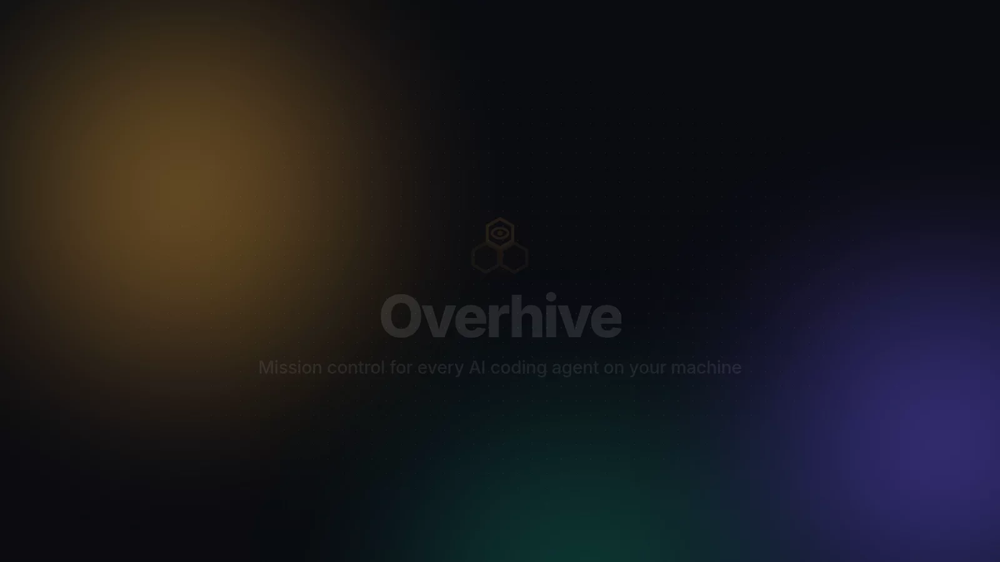

<p align="center"></p>

<h1 align="center">Overhive</h1>

<p align="center"><a href="https://github.com/Abhijeetsinghjat/overhive/actions/workflows/ci.yml"></a></p>

<p align="center"><b>Keep watch over every AI coding agent on your machine — any tool, free and open source.</b></p>

<p align="center"><b>🧪 Beta</b> · works on Linux and macOS (new); Windows in early preview · <a href="https://github.com/Abhijeetsinghjat/overhive/issues/new/choose">report a problem</a></p>

<p align="center"></p>
<p align="center"><sub>57-second tour with sample agents in a demo repository · ▶ <a href="https://github.com/user-attachments/assets/dc34ef94-923d-440e-8eac-943e7e16831d">Watch in full quality (1080p video)</a></sub></p>

Overhive is a local control center for AI coding agents. It shows every agent and sub-agent you run,
whatever tool runs it: Claude Code, Codex, Gemini CLI, Grok, Cursor, Copilot, Aider, OpenCode, or your own.
For each one you see:

- its status, with the evidence behind it
- its process, repository, worktree and branch
- the files it changed, with diffs
- its commands, tests, commits, token usage and conflicts
- its full timeline

You can message agents, pause or stop them, and start new sessions of any installed tool from the dashboard.

- **Free, Apache-2.0.** No account, no subscription, no paid services, no telemetry.
- **Your tools, your accounts.** Each AI tool signs in with your own subscription or key, as it always does.
  Overhive never asks for, reads or stores AI credentials.
- **Local only.** One daemon on `127.0.0.1` and a private Unix socket. Data stays in SQLite under
  `~/.local/state/agent-mission-control`.

> **Beta.** Overhive works and is used daily on Linux; macOS support is new and passes the full test suite
> on Apple Silicon, but has had few real users yet. Native Windows is an early preview that has not yet been tried
> on a real PC; WSL2 is the proven route on Windows today. Expect rough edges and please report them.

## Install

Every install gives you `amcd` (the daemon) and the CLI as `overhive` (also available as `agentctl`).
Open the dashboard at **http://127.0.0.1:47821**.

### macOS

With [Homebrew](https://brew.sh):

```bash
brew tap abhijeetsinghjat/overhive https://github.com/Abhijeetsinghjat/overhive
brew install overhive
brew services start overhive      # start now and at every login
```

Or from a release archive (no .NET needed): download `overhive-<version>-osx-arm64.tar.gz` (Apple Silicon) or
`osx-x64` (Intel) and `SHA256SUMS` from [Releases](https://github.com/Abhijeetsinghjat/overhive/releases), then:

```bash
shasum -a 256 --ignore-missing -c SHA256SUMS
tar -xzf overhive-<version>-osx-arm64.tar.gz
./overhive-<version>-osx-arm64/install-release.sh
```

The daemon starts at login through a launchd agent.

### Linux

From a release archive (no .NET needed): download `overhive-<version>-linux-x64.tar.gz` (or `linux-arm64`) and
`SHA256SUMS` from [Releases](https://github.com/Abhijeetsinghjat/overhive/releases), then:

```bash
sha256sum --ignore-missing -c SHA256SUMS
gh attestation verify overhive-<version>-linux-x64.tar.gz -R Abhijeetsinghjat/overhive   # optional: proves GitHub built it from this repo
tar -xzf overhive-<version>-linux-x64.tar.gz
./overhive-<version>-linux-x64/install-release.sh
```

The daemon starts at login through a systemd user service (`systemctl --user status amcd`).

### From source (Linux and macOS)

Needs the [.NET 10 SDK](https://dotnet.microsoft.com/download):

```bash
git clone https://github.com/Abhijeetsinghjat/overhive && cd overhive
scripts/install.sh
```

### Windows

**Native Windows (early preview).** Windows 10 1809 or later, 64-bit. Not yet tried on a real PC; please
[report](https://github.com/Abhijeetsinghjat/overhive/issues/new/choose) how it goes. The installer needs no
admin rights: it installs into `%LOCALAPPDATA%\Overhive`, puts `overhive` (also `agentctl`) and `amcd` on your
user PATH and starts the daemon at logon, hidden, through a per-user scheduled task named `Overhive`. It does
not change Claude Code or other AI-tool settings (`overhive hooks install` does that, separately).

From v0.3.0, a Windows build needs no .NET: download `overhive-<version>-win-x64.zip` and `SHA256SUMS`
from [Releases](https://github.com/Abhijeetsinghjat/overhive/releases), then in PowerShell:

```powershell
Get-FileHash overhive-<version>-win-x64.zip -Algorithm SHA256   # compare with SHA256SUMS
Expand-Archive overhive-<version>-win-x64.zip -DestinationPath .
powershell -ExecutionPolicy Bypass -File .\overhive-<version>-win-x64\install-release.ps1
```

Or with [Scoop](https://scoop.sh) (available shortly after each release, once its manifest is added):

```powershell
scoop bucket add overhive https://github.com/Abhijeetsinghjat/overhive
scoop install overhive
```

From source (needs the [.NET 10 SDK](https://dotnet.microsoft.com/download) and Git):

```powershell
git clone https://github.com/Abhijeetsinghjat/overhive; cd overhive
powershell -ExecutionPolicy Bypass -File scripts\install.ps1
```

Re-run the same command to update. Then open a new terminal and start an agent through Overhive:

```powershell
overhive run -- claude
```

To uninstall (your data in `%USERPROFILE%\.local\state\agent-mission-control` is kept unless you add
`-RemoveData`): `powershell -ExecutionPolicy Bypass -File "$env:LOCALAPPDATA\Overhive\install-release.ps1" -Uninstall`
(or `scripts\install.ps1 -Uninstall` from the clone, or `scoop uninstall overhive`). Logs, restart and more:
[Windows (native)](docs/TROUBLESHOOTING.md#windows-native).

Works natively: the dashboard, agent and process tracking with pause/resume/stop (stop is always a hard stop
on Windows), terminals for `agentctl run`, Git and conflict tracking, owner-only protection of the token
and database, starting at logon, and hooks for every tool in [Connect your AI tools](#connect-your-ai-tools).
Not yet: signed binaries (Windows SmartScreen may warn about the downloaded files).

**Or use WSL2.** Run your AI tools inside WSL and install Overhive there with the Linux steps above; open the
dashboard in your Windows browser. Setup and limits: [Windows via WSL2](docs/TROUBLESHOOTING.md#windows-via-wsl2).

## Connect your AI tools

Every tool works without setup: Overhive detects its running process and shows its folder, worktree,
file changes and commits. Press **+ New session** in the dashboard to start any installed tool in a
terminal Overhive owns, with live output and messaging.

For full detail (prompts, tool calls, files, usage, sub-agents and messages), connect the tool's hooks.
Each command shows what it will change, backs up the tool's config file first, and only ever touches
Overhive's own entries. `overhive hooks uninstall --tool <tool>` removes them again.

| Tool | Connect | Then |
|------|---------|------|
| Claude Code | `overhive hooks install` | Nothing. Running sessions pick it up; idle sessions are woken by messages. |
| Codex CLI | `overhive hooks install --tool codex` | In Codex, run `/hooks` once and trust the new hooks. |
| Gemini CLI | `overhive hooks install --tool gemini` | If Gemini asks, trust the hooks in `/hooks panel`. |
| Grok | `overhive hooks install --tool grok` | Monitoring only; Grok's hooks cannot carry messages back. |
| Cursor CLI | `overhive hooks install --tool cursor` | Nothing. |
| GitHub Copilot CLI | `overhive hooks install --tool copilot` | Nothing. |
| Any other tool | Add it to `~/.config/agent-mission-control/config.json` (see below), or report through the [open protocol](docs/PROTOCOL.md) with `overhive emit` | — |

Check a tool's status with `overhive hooks status --tool <tool>`.

On Windows the same commands work, but the hooks run `overhive hook-forward` (built into the CLI) instead of
curl, so neither curl nor Git Bash is needed. Claude Code needs a version with exec-form hooks (`args`). If you
move the CLI, run `overhive hooks install` again; `overhive doctor` checks the hook forwarder. Details:
[Hooks on Windows](docs/AGENT_INTEGRATION.md#hooks-on-windows).

Add a tool Overhive does not know yet:

```json
{ "Tools": [ { "Id": "mytool", "Name": "My Tool", "Command": "mytool", "ProcessNames": ["mytool"] } ] }
```

## Use

| Need | Where |
|------|-------|
| What is running, waiting, blocked, failed | Header counters, agent tree, `overhive agents` |
| Which agent needs me now (any tool) | **⚑ Needs you** badge (key `a`), Overview panel, `overhive attention`; opt-in browser, desktop or self-hosted ntfy notifications ([details](docs/NOTIFICATIONS.md)) |
| Check agents from a phone | `/m` through your own SSH tunnel or `tailscale serve` ([how](docs/REMOTE_ACCESS.md)) |
| Everything at a glance, in 3D | **Hive** tab (default when the browser has WebGL): each session is a honeycomb cell with its sub-agents around it, grouped by repository worktree; glow = status, height = tokens, red arcs = conflicts. Drag to orbit, click to open, **2D** switches to the Graph tab |
| Agent → sub-agent hierarchy, models, token usage | Hive or Graph tab, Usage tab, `overhive usage` |
| Repo / worktree / branch / HEAD per agent | Agent panel → Location, Worktrees & Files tab |
| Files changed, by whom, with diffs | Worktrees & Files tab, `overhive files`, `overhive diff <agent>` |
| Commits with links to your Git host | Commits tab |
| Conflicts between agents | Conflict banner, `overhive status`, `overhive conflicts` |
| Which lines overlap; warn the agents involved | Conflict banner / panel → **Warn agents**, `overhive conflicts warn <n>`; automatic with `"AutoWarnConflicts": true` |
| Risky actions (deletes outside the worktree, force-pushes, credential files, `curl \| sh`, publishes, DB drops) | Risks tab, red badge on the agent, `overhive risks` ([rules](docs/RISKS.md)) |
| Did the agent really do what it says? ("tests pass", "committed", "created X") | Agent panel → Verification; ✗ N on the agent's card and row |
| Runaway sub-agent fan-out or token burn | Runaway guard banner, agent panel, `overhive guard` ([details](docs/RUNAWAY_GUARD.md)) |
| Message an agent, pause, resume, stop | Agent panel, `overhive message <agent> "…"`, `overhive pause <agent>` |
| Start a new session of any tool | **+ New session** (key `n`), `overhive run -- <tool>` |
| Clean up a worktree after its PR merged | **Merged — clean up** on the worktree card / panel and in "Needs you", `overhive worktrees clean` ([below](#cleaning-up-merged-worktrees)) |
| Start an agent on its own branch in a fresh worktree | **+ New session** → Run in **a new worktree**, `overhive run --worktree <branch> -- <tool>` ([below](#a-session-in-a-new-worktree)) |
| Is Overhive itself healthy? | Health tab, `overhive status`, `overhive doctor` |

### A session in a new worktree

In **+ New session**, pick a folder inside a Git repository and choose **Run in: a new worktree**. Enter a branch
name (or tick **Use an existing branch**), pick the base from the searchable branch list (default: the remote
default branch such as `origin/main`, else the current branch) and check the location shown before starting.
Overhive runs `git worktree add` and starts the tool there. From a terminal inside the repository:

```
overhive run --worktree feat/login [--base origin/main] [--path DIR] [--existing] [--fetch] [--setup] -- claude
```

* New worktrees go to `<repo-parent>/<repo>.worktrees/<branch>` (`/` in the branch becomes `-`). Change it with
  `"NewWorktree": { "Root": "~/worktrees/{repo}" }` in `config.json`.
* **Fetch the base first** (`--fetch`) is off by default: Overhive does no network actions unless you ask.
* A new worktree is a fresh checkout: ignored files such as `node_modules` or `.env` are **not** there. Optionally
  set a per-repository setup command, offered in the dialog (off by default) and run with `--setup`:
  `"NewWorktree": { "SetupCommand": { "my-app": ["npm", "ci"] } }` (key: repository folder name or main worktree
  path; an argument list, never a shell line).
* Nothing is deleted automatically: if the tool or the setup command fails to start, the worktree stays and its
  path is reported. Worktrees created this way are marked "created by Overhive" in the worktree panel.

Every status, file attribution, test result and reply carries an evidence label: **observed** (the
OS or Git saw it), **reported** (the tool said so) or **inferred** (correlation). Overhive never shows
an agent as working, or as changing a file, without evidence.

### Cleaning up merged worktrees

Overhive notices when a linked worktree's branch is merged: through your own `gh` CLI when it is installed
and signed in (*observed*: the PR is merged and the worktree's HEAD is part of it), otherwise from git alone
without fetching (*inferred*, shown as "likely merged"). By default it only **suggests**: the worktree gets a
**Merged — clean up** button and a low-priority "Needs you" item; one click shows exactly what would be removed
and the result of every safety check, and asks before running `git worktree remove` (never `--force`) and
`git branch -d`. Nothing is removed while the worktree has uncommitted or untracked files, unpushed commits, is
locked or the main worktree, or while an agent, an Overhive terminal or any process is working inside it.
Ignored files that cannot be regenerated (`.env`, keys, local config; unlike `node_modules`, `bin`, `dist` …) are
listed and need a second confirmation (`--include-ignored`), and auto mode never deletes them.

```
overhive worktrees                       # list, with merged status
overhive worktrees clean                 # dry run: what would be removed and why / why not
overhive worktrees clean <path> --yes    # remove (add --include-ignored to also delete listed .env etc.)
```

Configure in `config.json`: `{"WorktreeCleanup": {"Mode": "suggest"}}` (`"auto"` removes after
`GracePeriodMinutes`, default 30, when every check passes; `"off"` disables it), `DeleteRemoteBranch` (default
false), `ExcludeRepositories` (names or paths), `RegenerableIgnored` (ignored paths safe to delete). Details: [ARCHITECTURE.md](docs/ARCHITECTURE.md#worktree-cleanup),
[SECURITY.md](docs/SECURITY.md).

## Documentation

- [Architecture](docs/ARCHITECTURE.md): system design, including what can and can't be known about an agent
- [Agent integration](docs/AGENT_INTEGRATION.md): how each tool is discovered and tracked
- [Open protocol](docs/PROTOCOL.md): let any tool or script report to Overhive
- [Runaway guard](docs/RUNAWAY_GUARD.md): warnings (and an optional automatic pause) for sub-agent fan-out and token burn
- [Attention queue and notifications](docs/NOTIFICATIONS.md), [Phone access](docs/REMOTE_ACCESS.md)
- [Event model](docs/EVENT_MODEL.md), [Security](docs/SECURITY.md), [Risky-action rules](docs/RISKS.md), [Dependencies](docs/DEPENDENCIES.md)
- [Development](docs/DEVELOPMENT.md), [Troubleshooting](docs/TROUBLESHOOTING.md), [Contributing](CONTRIBUTING.md)

## License

Apache License 2.0. See [LICENSE](LICENSE) and [NOTICE](NOTICE).
