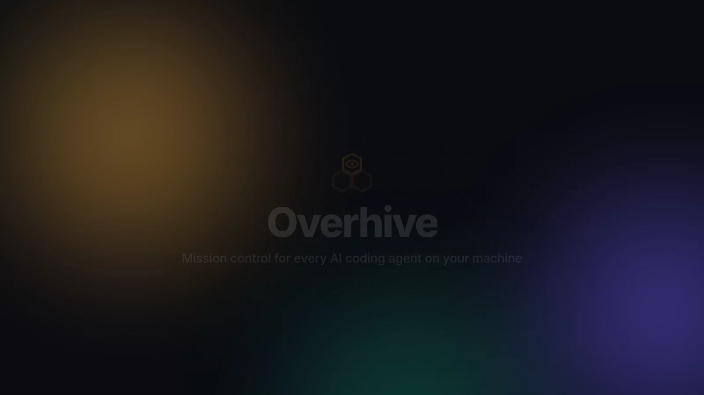

<p align="center"></p>

<h1 align="center">Overhive</h1>

<p align="center"><a href="https://github.com/Abhijeetsinghjat/overhive/actions/workflows/ci.yml"></a></p>

<p align="center"><b>Keep watch over every AI coding agent on your machine — any tool, free and open source.</b></p>

<p align="center"><b>🧪 Beta</b> · works on Linux today; macOS and Windows are on the way · <a href="https://github.com/Abhijeetsinghjat/overhive/issues/new/choose">report a problem</a></p>

<p align="center"></p>
<p align="center"><sub>44-second tour with sample agents in a demo repository · ▶ <a href="https://github.com/user-attachments/assets/dc34ef94-923d-440e-8eac-943e7e16831d">Watch in full quality (1080p video)</a></sub></p>

Overhive is a local control center for AI coding agents. It shows every agent and sub-agent you run,
whatever tool runs it: Claude Code, Codex, Gemini CLI, Grok, Cursor, Copilot, Aider, OpenCode, or your own.
For each one you see:

- its status, with the evidence behind it
- its process, repository, worktree and branch
- the files it changed, with diffs
- its commands, tests, commits, token usage and conflicts
- its full timeline

You can message agents, pause or stop them, and start new sessions of any installed tool from the dashboard.

- **Free, Apache-2.0.** No account, no subscription, no paid services, no telemetry.
- **Your tools, your accounts.** Each AI tool signs in with your own subscription or key, as it always does.
  Overhive never asks for, reads or stores AI credentials.
- **Local only.** One daemon on `127.0.0.1` and a private Unix socket. Data stays in SQLite under
  `~/.local/state/agent-mission-control`.

> **Beta.** Overhive works and is used daily on Linux, but it has had few users so far. Expect rough edges and
> please report them. macOS support comes next, then native Windows. On Windows today you can run it inside
> WSL2 (see [Troubleshooting](docs/TROUBLESHOOTING.md#windows-via-wsl2)).

## Install

From a release archive (no .NET needed). Download the archive for your machine (`linux-x64` or
`linux-arm64`) and `SHA256SUMS` from [Releases](https://github.com/Abhijeetsinghjat/overhive/releases), then:

```bash
sha256sum --ignore-missing -c SHA256SUMS
gh attestation verify overhive-<version>-linux-x64.tar.gz -R Abhijeetsinghjat/overhive   # optional: proves GitHub built it from this repo
tar -xzf overhive-<version>-linux-x64.tar.gz
./overhive-<version>-linux-x64/install-release.sh
```

From source (needs the .NET 10 SDK):

```bash
git clone https://github.com/Abhijeetsinghjat/overhive && cd overhive
scripts/install.sh
```

Both install `amcd` (the daemon, run as a systemd user service that starts on login) and the CLI as
`overhive` (also available as `agentctl`). Open the dashboard at **http://127.0.0.1:47821**.

## Connect your AI tools

Every tool works without setup: Overhive detects its running process and shows its folder, worktree,
file changes and commits. Press **+ New session** in the dashboard to start any installed tool in a
terminal Overhive owns, with live output and messaging.

For full detail (prompts, tool calls, files, usage, sub-agents and messages), connect the tool's hooks.
Each command shows what it will change, backs up the tool's config file first, and only ever touches
Overhive's own entries. `overhive hooks uninstall --tool <tool>` removes them again.

| Tool | Connect | Then |
|------|---------|------|
| Claude Code | `overhive hooks install` | Nothing. Running sessions pick it up; idle sessions are woken by messages. |
| Codex CLI | `overhive hooks install --tool codex` | In Codex, run `/hooks` once and trust the new hooks. |
| Gemini CLI | `overhive hooks install --tool gemini` | If Gemini asks, trust the hooks in `/hooks panel`. |
| Grok | `overhive hooks install --tool grok` | Monitoring only; Grok's hooks cannot carry messages back. |
| Cursor CLI | `overhive hooks install --tool cursor` | Nothing. |
| GitHub Copilot CLI | `overhive hooks install --tool copilot` | Nothing. |
| Any other tool | Add it to `~/.config/agent-mission-control/config.json` (see below), or report through the [open protocol](docs/PROTOCOL.md) with `overhive emit` | — |

Check a tool's status with `overhive hooks status --tool <tool>`.

Add a tool Overhive does not know yet:

```json
{ "Tools": [ { "Id": "mytool", "Name": "My Tool", "Command": "mytool", "ProcessNames": ["mytool"] } ] }
```

## Use

| Need | Where |
|------|-------|
| What is running, waiting, blocked, failed | Header counters, agent tree, `overhive agents` |
| Agent → sub-agent hierarchy, models, token usage | Graph tab, Usage tab, `overhive usage` |
| Repo / worktree / branch / HEAD per agent | Agent panel → Location, Worktrees & Files tab |
| Files changed, by whom, with diffs | Worktrees & Files tab, `overhive files`, `overhive diff <agent>` |
| Commits with links to your Git host | Commits tab |
| Conflicts between agents | Conflict banner, `overhive status` |
| Did the agent really do what it says? ("tests pass", "committed", "created X") | Agent panel → Verification; ✗ N on the agent's card and row |
| Message an agent, pause, resume, stop | Agent panel, `overhive message <agent> "…"`, `overhive pause <agent>` |
| Start a new session of any tool | **+ New session** (key `n`), `overhive run -- <tool>` |
| Is Overhive itself healthy? | Health tab, `overhive status`, `overhive doctor` |

Every status, file attribution, test result and reply carries an evidence label: **observed** (the
OS or Git saw it), **reported** (the tool said so) or **inferred** (correlation). Overhive never shows
an agent as working, or as changing a file, without evidence.

## Documentation

- [Architecture](docs/ARCHITECTURE.md): system design, including what can and can't be known about an agent
- [Agent integration](docs/AGENT_INTEGRATION.md): how each tool is discovered and tracked
- [Open protocol](docs/PROTOCOL.md): let any tool or script report to Overhive
- [Event model](docs/EVENT_MODEL.md), [Security](docs/SECURITY.md), [Dependencies](docs/DEPENDENCIES.md)
- [Development](docs/DEVELOPMENT.md), [Troubleshooting](docs/TROUBLESHOOTING.md), [Contributing](CONTRIBUTING.md)

## License

Apache License 2.0. See [LICENSE](LICENSE) and [NOTICE](NOTICE).
